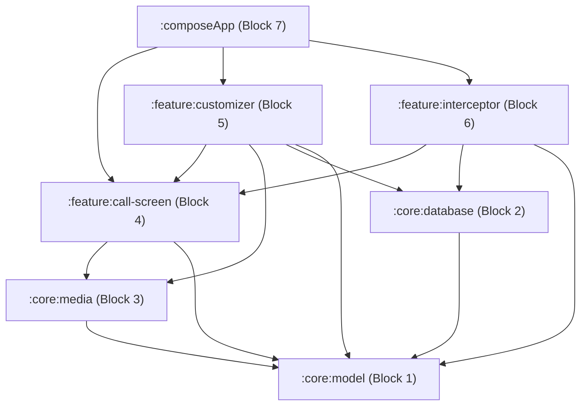

<div align="center">

# 🎬 CustomCall
### Cross-Platform Custom Video Incoming Call Screen Engine

[](https://kotlinlang.org/)
[](https://www.jetbrains.com/lp/compose-multiplatform/)
[](https://developer.android.com/)
[](https://kotlinlang.org/docs/multiplatform.html)
[](#%EF%B8%8F-modular-architecture)
[-crimson?style=for-the-badge)](LICENSE.md)

**Intercept cellular and VoIP calls (WhatsApp, Telegram, SIM) and render hardware-accelerated, contact-specific looping video call screens in under 200 ms.**

[Features](#-key-features) • [Platform Matrix](#-platform-capabilities--technical-realities) • [Architecture](#%EF%B8%8F-modular-architecture) • [Development Pipeline](#-7-block-serial-development-pipeline) • [Setup & Permissions](#-getting-started) • [License](#-license)

</div>

---

## 📖 Overview

**CustomCall** is a lightweight, modular mobile application built with **Kotlin Multiplatform (KMP)** and **Compose Multiplatform (CMP)**. Designed around strict Clean Architecture boundaries, it separates low-level OS call interception from a shared, high-performance video UI engine—enabling **85%–90% code reuse** across Android (modern and legacy) and future iOS targets.

Instead of relying on static caller ID screens, CustomCall intercepts incoming GSM and VoIP call events, resolves custom contact rules in **< 5 ms**, and renders gapless, hardware-decoded video themes directly over the lock screen or active apps.

---

## ✨ Key Features

* **📡 Multi-Source Call Interception:** Seamlessly captures incoming calls and answer/decline actions across standard cellular networks (**SIM/GSM**), **WhatsApp**, **WhatsApp Business**, **Telegram**, and extensible VoIP packages.
* **⚡ Sub-200ms Cold-Start Video Rendering:** Hardware-backed `SurfaceView` decoding with Media3 `ExoPlayer` (`REPEAT_MODE_ONE`) ensures zero black frames between loops and renders before native OS call screens flash.
* **🎞️ Automated Media Ingestion Pipeline:** Background transcoding via Media3 `Transformer` trims, scales (up to 1080p @ 30fps), and stores user-selected gallery videos in private internal storage (`filesDir/themes/`), preventing `SecurityException` errors on lock-screen wake.
* **🎯 Contact-Specific Rule Engine:** Indexed local persistence maps normalized phone numbers or VoIP handles to dedicated video themes, overriding global defaults in under 5 ms.
* **🎨 Adaptive UI & Control Styles:** Configurable vertical contrast scrims, audio mute toggles (preventing ringtone clash), custom accent colors, and swappable control layouts (`CLASSIC_DUAL`, `SWIPE_PILL`, `MINIMAL_GESTURE`).
* **🛡️ OEM Survival & Permission Diagnostic Center:** Built-in onboarding dashboard verifying real-time status for Notification Listener access, Overlay permissions, Android 14+ Full-Screen Intents, and OEM battery/autostart exemptions (HyperOS/MIUI, One UI, ColorOS).

---

## 🔍 Platform Capabilities & Technical Realities

Mobile operating systems enforce strict sandboxing around telephony and notifications. CustomCall is engineered around each platform's native constraints:

| Call Source / Platform | Technical Mechanism | Capabilities & Constraints |
| :--- | :--- | :--- |
| **Android: Cellular (SIM / GSM)** | `CallScreeningService` + `TelephonyCallback` (API 31+) / `PhoneStateListener` (API 26–30), or `InCallService` | Full detection of `RINGING`, `OFFHOOK`, and `IDLE` states. Supports lightweight overlay interception without forcing dialer replacement (with optional `ROLE_DIALER` support). |
| **Android: VoIP (WhatsApp, Telegram)** | `NotificationListenerService` + `PendingIntent` Action Capture | Monitors notifications tagged with `Notification.CATEGORY_CALL`, extracts caller metadata, caches original Answer/Decline `PendingIntent` actions in memory, and triggers them from the custom UI. |
| **Android: Screen Wake & Overlay** | `FullScreenIntent` + `SYSTEM_ALERT_WINDOW` | Uses `USE_FULL_SCREEN_INTENT` + `setShowWhenLocked(true)` / `setTurnScreenOn(true)` to wake locked screens, and `TYPE_APPLICATION_OVERLAY` to render above heads-up notifications when unlocked. |
| **iOS (Future Target)** | `CallKit` + `PushKit` / `CXCallDirectoryProvider` | Due to Apple's app sandbox, third-party apps cannot intercept GSM or WhatsApp/Telegram notifications. Shared KMP/CMP modules drive custom VoIP screens, simulated calls, and CallKit extensions. |

---

## 🏗️ Modular Architecture

Dependencies follow a strict unidirectional hierarchy (`:composeApp` → `:feature:*` → `:core:*`). Core modules contain zero references to feature implementations or platform-specific UI frameworks.

```text
CustomCallApp/
├── composeApp/                  # [Block 7] Root app, Koin DI graph, Navigation & Manifest
├── core/
│   ├── model/                   # [Block 1] Pure KMP domain models, enums & boundary interfaces
│   ├── database/                # [Block 2] KMP database schema, DAOs & CallRepository
│   └── media/                   # [Block 3] VideoBackgroundPlayer composable & asset transcoder
└── feature/
    ├── call-screen/             # [Block 4] Full-screen incoming call CMP UI & control styles
    ├── customizer/              # [Block 5] Theme studio, contact picker & OEM permission wizard
    └── interceptor/             # [Block 6] Android NotificationListener, GSM detector & WindowManager
```

### Dependency Flow



---

## 🛠️ Tech Stack

| Layer | Technology | Role |
| :--- | :--- | :--- |
| **Language & UI** | Kotlin 2.x + Compose Multiplatform (CMP) | Shared declarative UI across Android and future iOS targets. |
| **Concurrency** | Kotlin Coroutines + `StateFlow` / `SharedFlow` | Reactive, non-blocking event propagation from OS services to UI. |
| **Dependency Injection** | Koin Multiplatform | Decoupled binding of `:core:model` interfaces to concrete implementations. |
| **Local Storage** | Room Multiplatform / SQLDelight | Indexed SQLite persistence for themes, contact rules, and app settings. |
| **Video Engine** | AndroidX Media3 (`ExoPlayer` + `Transformer`) / `AVQueuePlayer` (iOS) | Hardware-accelerated gapless video looping and background transcoding. |
| **Android System Hooks** | `NotificationListenerService`, `CallScreeningService`, `TelephonyCallback`, `WindowManager` | Native VoIP notification parsing, GSM call state tracking, and overlay rendering. |

---

## 🔄 7-Block Serial Development Pipeline

This repository is structured for **Contract-First Serial Execution** across seven modular stages. Each block delivers a compiled, tested artifact with frozen public contracts before the next block begins:

| Order | Module | Responsibility | Upstream Inputs | Key Deliverables |
| :---: | :--- | :--- | :--- | :--- |
| **1** | `:core:model` | Domain entities (`IncomingCallEvent`, `CallThemeConfig`, `ContactRule`) & boundary interfaces | *None* | Frozen KMP interfaces (`CallRepository`, `VideoAssetProcessor`, `CallActionExecutor`) |
| **2** | `:core:database` | Local SQLite schema, indexed DAOs & rule resolution engine | `:core:model` | `CallRepository` implementation resolving contact rules in `< 5 ms` |
| **3** | `:core:media` | Gapless video player composable & background video optimizer | `:core:model` | `VideoBackgroundPlayer` (`SurfaceView`) & `VideoAssetProcessor` (`filesDir/themes/`) |
| **4** | `:feature:call-screen` | Edge-to-edge incoming call UI, scrim gradients & control styles | `:core:model`, `:core:media` | `IncomingCallScreen` composable + interactive theme `@Preview` suite |
| **5** | `:feature:customizer` | Video picker, live theme studio, contact rules & OEM permission center | Blocks 1–4 | Full configuration UX & real-time system permission diagnostic wizard |
| **6** | `:feature:interceptor` | Native Android VoIP/GSM listeners & lock-screen overlay manager | `:core:model`, `:core:database`, `:feature:call-screen` | `CallNotificationListenerService`, GSM detector & `IncomingCallActivity` |
| **7** | `:composeApp` | Root DI wiring, navigation graph, Manifest permissions & R8 release | Blocks 1–6 | Signed production APK/AAB & `iosMain`-ready codebase |

---

## 🚀 Getting Started

### Prerequisites
* **Android Studio:** Ladybug (2024.2.1) or newer with Kotlin Multiplatform plugin enabled.
* **JDK:** Java 17 or Java 21.
* **Target Device:** Physical Android device (API 26–36+) recommended for testing live GSM, WhatsApp, and Telegram call interception.

### Build & Run
```bash
# Clone the repository
git clone [https://github.com/your-username/CustomCall.git](https://github.com/your-username/CustomCall.git)
cd CustomCall

# Run common unit tests across core modules
./gradlew :core:model:testDebugUnitTest :core:database:testDebugUnitTest

# Assemble the debug APK
./gradlew :composeApp:assembleDebug
```

### Required Android Permissions
To function reliably across modern Android versions and strict OEM skins, the app declares and guides users through enabling:
* `android.permission.BIND_NOTIFICATION_LISTENER_SERVICE` — Captures incoming VoIP call notifications and action intents.
* `android.permission.SYSTEM_ALERT_WINDOW` — Renders the custom video overlay when the device is unlocked.
* `android.permission.USE_FULL_SCREEN_INTENT` — Wakes the device and displays `IncomingCallActivity` over the lock screen (Android 14+).
* `android.permission.READ_CONTACTS` & `android.permission.READ_PHONE_STATE` — Matches incoming callers to custom contact rules.
* `android.permission.REQUEST_IGNORE_BATTERY_OPTIMIZATIONS` — Prevents background listener termination during deep sleep.

---

## 🗺️ Roadmap

- [x] **Phase 1:** Modular KMP architecture & Contract-First 7-block pipeline specification.
- [ ] **Phase 2:** Core domain contracts (`:core:model`), indexed database (`:core:database`), and Media3 transcoding engine (`:core:media`).
- [ ] **Phase 3:** Compose Multiplatform incoming call UI (`:feature:call-screen`) & Theme Studio (`:feature:customizer`).
- [ ] **Phase 4:** Android VoIP/GSM interception engine (`:feature:interceptor`) & OEM survival diagnostics.
- [ ] **Phase 5:** iOS `iosMain` target integration (`AVQueuePlayer` + `CallKit` bridge).

---

## 🤝 Contributing

Contributions must respect the module dependency boundaries defined in [Modular Architecture](#%EF%B8%8F-modular-architecture):
1. Never introduce platform-specific Android imports into `:core:model`, `:core:database`, or `:feature:call-screen`.
2. Any change to public interfaces in `:core:model` requires updating unit tests and documenting the contract revision.
3. Ensure all video resources allocated in `VideoBackgroundPlayer` are deterministically released on lifecycle termination.

**Contributor License Grant:** Unless accompanied by a separate written agreement, submitting any contribution to this repository grants the copyright holder (**Ney Cordovez**) an irrevocable, worldwide, non-exclusive, royalty-free right to use, reproduce, modify, distribute, and sublicense the contribution for any purpose, as detailed in Section 5 of [LICENSE.md](LICENSE.md). Contributors are responsible for ensuring they hold the necessary rights to submit their contributions.

---

## 📄 License

**Copyright © 2026 Ney Cordovéz. All Rights Reserved.**

This project is distributed under a **Custom Software License** (see [LICENSE.md](LICENSE.md) for full legal terms):

* **✅ Personal & Educational Use:** You are granted a non-exclusive, revocable license to use, run, copy, modify, and redistribute this software strictly for private, educational, research, training, or non-commercial purposes.
* **🔄 Redistribution Conditions:** Any redistribution must preserve `LICENSE.md` and copyright notices, clearly identify any modifications made, attribute **Ney Cordovez** with a link to the original repository, remain under the exact same license terms, and avoid implying endorsement.
* **🚫 Commercial Use Restricted:** Commercial use, monetization, sublicensing, or deployment as part of a paid product or business operation is strictly prohibited without prior written permission from the copyright holder.

For commercial licensing inquiries, contact: **[22.mashiro.07@gmail.com](mailto:22.mashiro.07@gmail.com)**